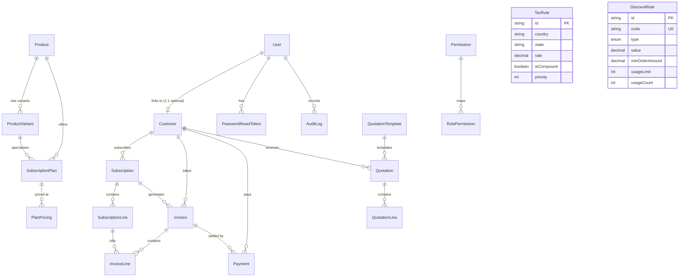

# Database Architecture: Brightloop Subscription Management System

This document outlines the complete relational database architecture designed for Brightloop Software's Subscription Management System. It serves as the primary contract and single source of truth for all four engineering modules: Backend Foundation, Subscriptions & Billing, Products & Pricing, and Dashboard & Customer Portal.

---

## 1. Entity Relationship Diagram (ERD)

---

## 2. Model Specifications & Schema Design

### 2.1 Core Authentication & Access Control
- **`User`**: Core identity model supporting `ADMIN`, `STAFF`, and `CUSTOMER` roles. Accounts have hashed passwords (bcrypt), account status (`ACTIVE`, `SUSPENDED`, `PENDING`), and optional 1:1 relation to a `Customer` profile.
- **`PasswordResetToken`**: Time-limited single-use security tokens. Plain tokens are never stored; only a cryptographic SHA-256 `tokenHash` is saved with an `expiresAt` timestamp and `usedAt` tracking.
- **`Permission` & `RolePermission`**: Normalized role-permission matrix defining granular capabilities (`users:manage`, `customers:manage`, `taxes:manage`, `invoices:manage`).

### 2.2 Customer Domain
- **`Customer`**: Represents individual or enterprise accounts.
  - Unique `customerNumber` (e.g. `CUST-00001`) and unique `email`.
  - Structured JSON fields for `billingAddress` and `shippingAddress`.
  - Default `currency` (`USD`) and `taxExempt` boolean flag.
  - 1:1 optional link to `User` (`userId`), enabling customer self-service through the portal while maintaining data isolation.

### 2.3 Product & Pricing Catalog
- **`Product`**: Commercial software products (e.g. "Brightloop Cloud Platform") with unique SKU/code.
- **`ProductVariant`**: Tier, size, or region variations (e.g. Standard vs Enterprise cluster) with flexible JSON `attributes`.
- **`SubscriptionPlan`**: Recurring plan definition linked to product and optional variant. Defines `billingInterval` (`DAY`, `WEEK`, `MONTH`, `YEAR`), `intervalCount`, and `trialPeriodDays`.
- **`PlanPricing`**: Explicit decimal monetary pricing (`amount @db.Decimal(12, 2)` and `setupFee @db.Decimal(12, 2)`), currency code, and temporal validity (`effectiveFrom`, `effectiveTo`).

### 2.4 Taxes & Discounts
- **`TaxRule`**: Jurisdiction-based tax rates (`rate @db.Decimal(5, 4)` e.g., `0.0825` for 8.25%). Supports state/country matching, compound tax calculation, and priority order.
- **`DiscountRule`**: Promotional codes with either `PERCENTAGE` or `FIXED_AMOUNT` discounts, minimum spend thresholds, max discount caps, and usage limits.

### 2.5 Quotations & Proposals
- **`QuotationTemplate`**: Pre-approved terms and legal notices for rapid quote generation.
- **`Quotation` & `QuotationLine`**: Formal sales proposals with valid-until dates, status lifecycle (`DRAFT` -> `SENT` -> `ACCEPTED` / `REJECTED` / `EXPIRED`), subtotal, taxes, discounts, and total amount.

### 2.6 Subscriptions & Recurring Lines
- **`Subscription`**: Active subscription agreement.
  - Unique `subscriptionNumber` (e.g. `SUB-2026-0001`).
  - Status state machine: `TRIALING`, `ACTIVE`, `PAST_DUE`, `PAUSED`, `CANCELLED`, `EXPIRED`.
  - Period tracking: `currentPeriodStart`, `currentPeriodEnd`, `trialStart`, `trialEnd`.
  - Renewal flags: `autoRenew`, `cancelAtPeriodEnd`, `cancelledAt`.
- **`SubscriptionLine`**: Individual recurring components, add-ons, or compute units with quantity, unit price, and line totals.

### 2.7 Invoices & Billing
- **`Invoice`**: Official financial ledger for subscription periods or one-off charges.
  - Unique `invoiceNumber` (e.g. `INV-2026-0001`).
  - Statuses: `DRAFT`, `OPEN`, `PAID`, `VOID`, `UNCOLLECTIBLE`.
  - Financial columns: `subtotal`, `taxAmount`, `discountAmount`, `totalAmount`, `amountPaid`, `amountDue` (all `Decimal(12, 2)`).
- **`InvoiceLine`**: Itemized charges referencing `SubscriptionLine` with billing period ranges.

### 2.8 Payments & Settlements
- **`Payment`**: Inbound settlements.
  - Unique `paymentNumber` (e.g. `PAY-2026-0001`).
  - Methods: `CREDIT_CARD`, `BANK_TRANSFER`, `STRIPE`, `MANUAL`, `OTHER`.
  - Provider transaction tracking: `providerTransactionId` (Stripe charge ID) and `paidAt`.

### 2.9 Audit Trail
- **`AuditLog`**: System-wide compliance and security trail recording actor `userId`, `action`, target `entityType` and `entityId`, `oldValues`, `newValues`, IP address, and client user-agent.

---

## 3. Financial Precision & Timestamp Handling

1. **Monetary Precision**: All monetary values are strictly typed as `Decimal @db.Decimal(12, 2)` in PostgreSQL to eliminate IEEE-754 floating-point inaccuracies. Tax rates use `@db.Decimal(5, 4)`.
2. **Date & Time Standards**: All timestamps (`createdAt`, `updatedAt`, `currentPeriodStart`, `currentPeriodEnd`) are persisted in UTC (`TIMESTAMPTZ` in PostgreSQL). Billing renewal calculations must use UTC boundaries.
3. **Unique Keys & Indexes**: Strategic B-tree indexes are placed on frequently queried fields (`customerId`, `subscriptionId`, `status`, `invoiceNumber`, `email`, `code`) to guarantee high-performance lookup and pagination.
